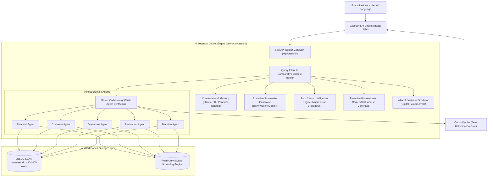

# PHASE 14 — ADVANCED AI BUSINESS COPILOT & DECISION INTELLIGENCE
## MASTER EXECUTION PLAN & ARCHITECTURAL SPECIFICATION

**Document ID**: `NEWCHAGES/PHASE14/PHASE_PLAN.md`  
**Phase**: Phase 14 — Advanced AI Business Copilot & Decision Intelligence  
**Status**: APPROVED & IN EXECUTION  
**Date**: 2026-11-15  
**Lead Engineer / AI Architect**: Google DeepMind Agentic System (Antigravity)  

---

## 1. OBJECTIVE & EXECUTIVE MANDATE

Transform NovaNest into an advanced conversational AI-powered Food Delivery Business Intelligence and Decision Support Platform. Executives and business leaders must be empowered to interact with the entire enterprise data footprint through natural language queries, conduct causal root-cause investigations, evaluate AI-generated executive summaries, receive proactive business alerts, simulate counterfactual scenarios using the Digital Twin, and execute evidence-grounded recommendations governed by mandatory human approval.

This must extend the existing NovaNest architecture (FastAPI, React SPA, MySQL 8.0.46, Master Orchestrator, 5 Domain Agents, Prescriptive Engine, and Digital Twin). No separate prototypes or synthetic mock environments are permitted.

---

## 2. PRE-IMPLEMENTATION AUDIT FINDINGS

### 2.1 Component & Service Inventory

| Architectural Layer | Existing Components Audited | Phase 14 Reuse & Integration Strategy |
|---|---|---|
| **Multi-Agent Engine** | `MasterOrchestrator`, `FinancialAgent`, `CustomerAgent`, `OperationsAgent`, `RestaurantAgent`, `DecisionAgent`, `synthesizer.py`, `output_verifier.py`, `tracing.py` | Reuse in-process hub-and-spoke multi-agent architecture; enhance multi-agent synthesis, cross-domain causal investigations, and execution tracing. |
| **Conversational Memory** | `conversation_manager.py` (30-min idle TTL, 250 LRU cap, HMAC principal isolation, entity regexes, `resolve_follow_up_query_and_context`) | Expand entity memory to support comparative queries ("Compare it with Hyderabad"), drill-down reasoning ("Why is Bangalore lower?"), and explicit filter synchronization. |
| **Root Cause Intelligence** | `python/ai/analyst/root_cause.py` (`_rca_delivery_delays`, `_rca_cancellations`, `_rca_leakage`, `_rca_restaurants`, `_rca_customer_churn`) | Expose structured causal breakdown API, quantify dimension contributions, separate correlation from causation, and provide investigative recommendations. |
| **Scenario Simulator & Digital Twin** | `python/decision/scenario_simulation_engine.py`, `python/decision_simulation/simulator.py`, `python/digital_twin/engine.py` | Unify into an executive What-If Simulator with 6 business levers, baseline vs proposed comparison, financial/operational metrics, and strict `is_simulation_projection: True` guardrails. |
| **Prescriptive Engine** | `python/decision/prescriptive_engine.py`, `recommendation_lifecycle.py` (`HumanApprovalRequiredError`, 6 lifecycle states) | Embed explainable recommendations directly inside Copilot responses with evidence data, root causes, financial impacts, and human approval workflow action buttons. |
| **Relational Database** | MySQL 8.0.46 `novanest_db` (304,405 records across 10 tables, 11 foreign keys, 19 indexes) | Read-only access via connection pool with zero mutations. No arbitrary SQL execution permitted. |
| **React Executive Frontend** | Phase 13 Executive Dashboard, `GlobalFilterBar.tsx`, `KpiCard.tsx`, `AnimatedTopDock.tsx`, `Sidebar.tsx`, glassmorphic CSS | Build premium `ExecutiveAiCopilot.tsx` interface matching Phase 13 styling with quick prompt chips, inline KPI cards, charts, evidence cards, and recommendation controls. |

### 2.2 Canonical Data Baseline
- **Database**: `novanest_db` on MySQL 8.0.46 container `novanest-db`.
- **Row Counts**: Exactly 304,405 records across all 10 canonical tables (`customers: 5,000`, `restaurants: 1,500`, `menu_items: 15,000`, `riders: 4,000`, `payments: 49,971`, `deliveries: 49,971`, `app_events: 100,000`, `promotions: 200`, `ratings_reviews: 28,792`, `orders: 49,971`).
- **Data Protection Constraint**: ZERO data mutations or table modifications permitted during Phase 14.

---

## 3. PHASE 14 ARCHITECTURAL BLUEPRINT

---

## 4. MILESTONES & WORK BREAKDOWN STRUCTURE

| Milestone | Title | Focus Area | Deliverable |
|---|---|---|---|
| **Milestone 1** | Pre-Implementation Audit & Master Plan | Architecture & Schema Audit | `NEWCHAGES/PHASE14/PHASE_PLAN.md` |
| **Milestone 2** | Executive AI Copilot Core Engine | Multi-Intent Routing & Epistemic Attribution | `python/ai/copilot/copilot_engine.py` |
| **Milestone 3** | AI-Generated Executive Summaries | Daily, Weekly, Monthly & Domain Summaries | `python/ai/copilot/executive_summaries.py` |
| **Milestone 4** | Root Cause Intelligence Engine | Causal Factor Breakdown & Uncertainty Bounds | `python/ai/copilot/root_cause_engine.py` |
| **Milestone 5** | Proactive Business Alert Center | Multidimensional Anomaly & Risk Detection | `python/ai/copilot/business_alerts.py` |
| **Milestone 6** | Digital Twin What-If Business Simulator | 6 Business Simulation Levers with Counterfactuals | Enhanced `scenario_simulation_engine.py` |
| **Milestone 7** | Explainable Recommendations & Approval | Prescriptive Governance Integration | Copilot Action Recommendation Cards |
| **Milestone 8** | Conversational Memory & Comparative Context | Multi-Turn Reasoning & Entity Persistence | Enhanced `conversation_manager.py` |
| **Milestone 9** | FastAPI Copilot Gateway & Endpoints | REST Endpoints under `/api/copilot/*` | `api/main.py` routing & RBAC enforcement |
| **Milestone 10** | Advanced Copilot UI in React | Interactive Panel, Cards, Charts & Quick Chips | `frontend/src/components/ExecutiveAiCopilot.tsx` |
| **Milestone 11** | UI Integration & Production Build | View Integration & Vite Production Compilation | Clean `npm run build` & Nginx deployment |
| **Milestone 12** | Performance & Latency Benchmarks | Single/Multi-Agent & Query Response Timing | Performance measurement logs |
| **Milestone 13** | Verification Test Suite & Regression | Automated Testing on Live Containers | `tests/test_phase14_ai_copilot.py` (100% PASS) |
| **Milestone 14** | Visual Evidence & Governance Documentation | Full-Viewport Screenshots & Master Registers | Complete `NEWCHAGES/PHASE14/` & ADR-040 |

---

## 5. SCIENTIFIC HONESTY & GOVERNANCE BOUNDARIES

1. **Epistemic Classification**:
   - Every AI response, summary, and alert must explicitly categorize claims into:
     - **Verified Facts**: Exact historical records derived from MySQL `novanest_db`.
     - **Model Predictions**: Machine learning outputs with confidence levels and tiers (`HIGH_EMPIRICAL` vs `LOW_EMPIRICAL`).
     - **AI Interpretations**: Analytical synthesis combining data points across business domains.
     - **Simulated Projections**: Hypothetical counterfactual estimates carrying `is_simulation_projection: True`.
2. **Correlation vs. Causation**:
   - The Root Cause Intelligence engine must explicitly state: *"Correlation does not imply direct causation; observational analysis suggests primary contributing factors."*
3. **Statistical Anomalies vs. Losses**:
   - The Alert Center must distinguish statistical distribution outliers (e.g. Tukey IQR, Z-Score $\ge 2.5$) from confirmed operational fraud or financial loss (`is_confirmed_loss: False`).
4. **Mandatory Human-in-the-Loop**:
   - No business action or configuration change may be executed autonomously. All recommendations require authorized human approval (`approve` / `reject`).
5. **Zero Data Mutation**:
   - MySQL `novanest_db` remains 100% read-only with all 304,405 records preserved.
