# NovaNest — Phase 15: Advanced Power BI & Executive Intelligence
# Phase Implementation Plan & Architecture Specification

---

## 1. Executive Summary & Objective

The objective of **Phase 15: Advanced Power BI & Executive Intelligence** is to transform the existing NovaNest Power BI report (`powerbi/NovaNest.pbix`) into a unified, enterprise-grade Food Delivery Business Intelligence and Decision Intelligence platform.

The enhanced Power BI platform unifies:
1. **Executive Overview Dashboard**: 10 canonical C-suite KPIs with period-over-period variance, trend indicators, definitions, and freshness indicators.
2. **Financial Intelligence**: Daily, weekly, monthly gross vs. net revenue, contribution margin, payment distributions, discounts, and transaction drill-through.
3. **Customer 360 Analytics**: Acquisition, RFM segmentation, CLV, cohort dynamics, new vs. repeat orders, VIP customers, with strict `LOW_EMPIRICAL` churn labeling.
4. **Restaurant Intelligence**: Rankings, prep time SLAs, cancellation rates, commission yield, and restaurant-level drill-through.
5. **Rider & Delivery Analytics**: Delivery vitals, SLA compliance, rider rankings, city efficiency, and explicit `BASELINE_ONLY` telematics notices.
6. **City-Wise Business Intelligence**: Dedicated geographical analytics page comparing Bangalore, Chennai, Hyderabad, Coimbatore, and Vijayawada.
7. **Predictive Analytics**: Machine learning model inferences (demand, ETA, churn, anomalies) showing predictions, intervals, confidence, and status.
8. **AI Insights Integration**: Phase 14 AI Copilot integration via approved REST APIs, providing grounded executive summaries, causal root causes, and proactive alerts.
9. **Advanced Power BI Features**: Bookmarks, report-page tooltips, drill-through pages, dynamic titles, field parameters, slicer synchronization, and mobile layouts.
10. **Data Source & Governance**: Explicit mapping of MySQL `orders_table` vs canonical `orders` view, automated refresh runbook, and a 20+ KPI cross-platform reconciliation matrix.

---

## 2. Pre-Implementation Audit of Existing Assets

### 2.1 File Metadata & Integrity Verification
- **Target File**: `powerbi/NovaNest.pbix`
- **File Size**: 5,638,573 bytes (~5.64 MB).
- **Archive Contents**:
  - `DataModel`: 5,615,005 bytes (XPress9 compressed Analysis Services ABF tabular package).
  - `Report/Layout`: 369,168 bytes (UTF-16LE JSON defining sections, visual containers, layout bounds, filters, and projections).
  - `DiagramLayout`: 5,042 bytes (12 diagram nodes and visual table positioning metadata).
  - `Report/StaticResources/SharedResources/BaseThemes/CY24SU10.json`: 6,175 bytes (Corporate theme).
  - `Settings`: 276 bytes (Query settings, schema version 2.146.304.0).
  - `Metadata`: 192 bytes (Engine release 2025.08).
- **Asset Protection Protocol**:
  - Original file backed up to `powerbi/NovaNest_backup_phase15.pbix` (5,638,573 bytes) prior to inspection or modification. Never overwrite the only working PBIX.

### 2.2 Power BI Data Model & Tables Audit
Extracted via `pbixray` binary parser:
- **Total Tables**: 14 (12 business/data tables + 2 internal local date tables):
  1. `orders`: Central fact table (49,971 rows).
  2. `deliveries`: Delivery fulfillment fact/dimension (49,971 rows).
  3. `payments`: Payment transaction dimension (49,971 rows).
  4. `customers`: Customer dimension (5,000 rows).
  5. `restaurants`: Merchant partner dimension (1,500 rows).
  6. `menu_items`: Product catalogue dimension (15,000 rows).
  7. `riders`: Delivery fleet dimension (4,000 rows).
  8. `promotions`: Marketing campaign dimension (200 rows).
  9. `ratings_reviews`: Customer feedback dimension (28,792 rows).
  10. `app_events`: Mobile app clickstream dimension (100,000 rows).
  11. `Measure_table`: Dedicated measure container (27 measures).
  12. `Date_Table`: Central calendar date dimension.
  13. `LocalDateTable_*`: Power BI auto-generated date hierarchy tables.

### 2.3 Existing Model Relationships Audit (Star Schema)
| From Table | From Column | To Table | To Column | Cardinality | Cross-Filtering | Status |
|---|---|---|---|---|---|---|
| `orders` | `customer_id` | `customers` | `customer_id` | N : 1 | Single | Active |
| `orders` | `restaurant_id` | `restaurants` | `restaurant_id` | N : 1 | Single | Active |
| `orders` | `rider_id` | `riders` | `rider_id` | N : 1 | Single | Active |
| `orders` | `item_id` | `menu_items` | `item_id` | N : 1 | Single | Active |
| `deliveries` | `order_id` | `orders` | `order_id` | 1 : 1 | Both | Active |
| `payments` | `order_id` | `orders` | `order_id` | 1 : 1 | Both | Active |
| `ratings_reviews` | `order_id` | `orders` | `order_id` | N : 1 | Single | Active |
| `app_events` | `customer_id` | `customers` | `customer_id` | N : 1 | Single | Active |

### 2.4 Power Query (M) Transformations Audit
- **Source Paths**: Currently contains legacy hardcoded file paths pointing to `D:\DATA ANALYTICS\NovaNest-360-Startup-Intelligence-Ecosystem\datasets\cleaned\*.csv`.
- **Finding**: The original author loaded static CSV extracts into the PBIX.
- **Remediation**:
  1. Document explicit Power Query M source migration to native MySQL 8.0 `novanest_db` via `MySQL.Database("db:3306", "novanest_db", [ReturnSingleDatabase=true])`.
  2. Map `orders` table to the canonical MySQL `orders` view (which selects all columns from `orders_table`), permanently resolving the `orders` vs `orders_table` naming difference.
  3. Ensure seamless dual-mode support (direct MySQL ingestion and local CSV offline fallback).

### 2.5 Existing DAX Measures Audit (33 Measures)
The existing PBIX contains 33 DAX measures distributed across `Measure_table`, `orders`, and `promotions`:
- Basic volume and revenue: `[Total Orders]`, `[Delivered Orders]`, `[Cancelled Orders]`, `[Total Revenue]`, `[Average Order Value]`.
- Operational metrics: `[Average Delivery Time]`, `[Average Delivery Distance]`, `[Delivery Success Rate]`, `[Cancellation Rate %]`.
- Simplified unit economics: `[Estimated Profit] = [Total Revenue] * 0.20` and `[Profit Margin] = DIVIDE([Estimated Profit], [Total Revenue]) * 100`.
- **Gap Identified**:
  - Legacy `Estimated Profit` uses a flat 20% multiplier. Canonical unit economics across MySQL, FastAPI, React, and Streamlit defines Contribution Margin as:
    $$\text{Contribution Margin} = \text{Commission Revenue} + \text{Delivery Fees} - \text{Discounts} - \text{Operating Costs}$$
    which evaluates to 23.59% - 24.54% (₹10,953,031 to ₹11,393,293).
  - Missing period-over-period DAX time intelligence measures (Prior Month, Variance, Growth %) for all 10 canonical KPI cards.
  - Missing customer retention vs repeat order distinction measures.

### 2.6 Existing Report Pages Audit (5 Sections, 66 Visuals)
1. Section 1 (`705293db9304d599ceb6`): **Executive Command Dashboard** (16 visuals)
2. Section 2 (`41ad09a314cec1275a00`): **Customer and product Intelligence** (12 visuals)
3. Section 3 (`83953db3656789c86038`): **Restaurant Intelligence** (12 visuals)
4. Section 4 (`9c748c7487e397554da2`): **Operations Intelligence** (12 visuals)
5. Section 5 (`b0b917d2480c2232ee43`): **Financial & Growth Intelligence** (14 visuals)
- **Gaps Identified**:
  - Lacks dedicated City-Wise Business Intelligence page (Section 8 requirement).
  - Lacks Predictive Analytics page with ML model confidence and intervals (Section 9 requirement).
  - Lacks AI Insights Integration page surfacing Phase 14 Copilot outputs (Section 10 requirement).
  - Lacks transaction and restaurant drill-through pages (Section 4, 6 requirement).
  - Lacks bookmarks, report-page tooltips, and mobile view layouts (Section 11 requirement).

---

## 3. Architecture & Target Design Specification

```mermaid
flowchart TD
    subgraph DataTier["Data Tier & Ingestion"]
        MySQL[("MySQL 8.0 novanest_db")]
        OrdersView["canonical view: orders (from orders_table)"]
        CSVFallback["CSV Cleaned Datasets (Fallback)"]
        MLFiles["Engineered ML Outputs (predictions & anomalies)"]
        CopilotAPI["Phase 14 Copilot Gateway (/api/copilot/*)"]
    end

    subgraph DataModel["Power BI Star Schema Model (14 Tables)"]
        FactOrders["orders (Fact_Orders)"]
        FactDeliv["deliveries (Fact_Deliveries)"]
        DimCust["customers (Dim_Customers)"]
        DimRest["restaurants (Dim_Restaurants)"]
        DimRider["riders (Dim_Riders)"]
        DimMenu["menu_items (Dim_Menu)"]
        DimPay["payments (Dim_Payments)"]
        DimPromo["promotions (Dim_Promotions)"]
        DimRatings["ratings_reviews (Dim_Ratings)"]
        DimEvents["app_events (Dim_Events)"]
        DimDate["Date_Table (Calendar Dimension)"]
        Measures["Measure_table (55+ Canonical DAX Measures)"]
    end

    subgraph ReportPages["Power BI Enterprise Visual Layout (9 Pages + Drill-through)"]
        P1["1. Executive Overview Dashboard (10 KPI Cards + Slicers)"]
        P2["2. Financial Intelligence & Unit Economics"]
        P3["3. Customer 360 & Retention Analytics"]
        P4["4. Restaurant Performance & SLA Intelligence"]
        P5["5. Rider Fleet & Delivery Operations"]
        P6["6. City-Wise Geographical Intelligence"]
        P7["7. Predictive Analytics & ML Quality"]
        P8["8. AI Copilot Insights & Decision Support"]
        P9["9. Financial Transaction Drill-through"]
        P10["10. Restaurant Partner Drill-through"]
    end

    MySQL --> OrdersView --> FactOrders
    MySQL --> FactDeliv & DimCust & DimRest & DimRider & DimMenu & DimPay & DimPromo & DimRatings & DimEvents
    CSVFallback -.-> FactOrders
    MLFiles --> P7
    CopilotAPI --> P8
    FactOrders --> ReportPages
    Measures --> ReportPages
```

---

## 4. Implementation Milestones

- **Milestone 1**: Pre-Implementation Audit & PBIX Asset Protection Backup (`NovaNest_backup_phase15.pbix`).
- **Milestone 2**: Data Model & Canonical DAX Measures Governance:
  - Implement full 10 KPI card DAX measures with period-over-period time intelligence (`Previous Month`, `Variance`, `Growth %`, `Trend Indicator`).
  - Implement audited Contribution Margin & Unit Economics DAX formulas matching canonical backend.
  - Implement Customer Retention vs. Repeat Order distinction and RFM scoring measures.
  - Define explicit mapping for `orders` vs `orders_table`.
- **Milestone 3**: Report Layout Enhancement & Expansion:
  - Page 1: Executive Overview Dashboard (10 certified KPI cards, trend sparks, definition tooltips).
  - Page 2: Financial Intelligence (Gross vs. Net, monthly trends, payment method donut, discount impact).
  - Page 3: Customer 360 (Acquisition trajectory, new vs. repeat, CLV, RFM tiers, `LOW_EMPIRICAL` churn).
  - Page 4: Restaurant Intelligence (Top 20 rankings, prep duration SLAs, cancellation rates, commission yield).
  - Page 5: Rider & Delivery Analytics (Delivery vitals, late delivery %, rider ranking, `BASELINE_ONLY` telematics notice).
  - Page 6: City-Wise Business Intelligence (City revenue, orders, delivery success, contribution margin).
  - Page 7: Predictive Analytics (Demand forecast, ETA predictions, churn risk, anomaly detection).
  - Page 8: AI Copilot Insights (Executive summaries, causal root causes, proactive alerts, What-If simulation).
  - Page 9 & 10: Drill-through Pages (Transaction level & Restaurant partner level).
- **Milestone 4**: Advanced Power BI Features (Bookmarks, Tooltip Pages, Mobile Layouts, Interactive Slicers).
- **Milestone 5**: MySQL Connection & Enterprise Refresh Configuration Runbook.
- **Milestone 6**: 20+ Cross-Platform KPI Reconciliation Matrix (MySQL vs FastAPI vs React vs Streamlit vs Power BI).
- **Milestone 7**: Automated Verification & Regression Suite (`tests/test_phase15_powerbi_intelligence.py`, Phase 14, Phase 13, Phase 11 UAT).
- **Milestone 8**: Visual Verification & Screenshot Capture.
- **Milestone 9**: Governance Documentation & Final Acceptance Sign-off.

---

## 5. Security, Risk & Guardrails

1. **Asset Protection**: The original `powerbi/NovaNest.pbix` is backed up and never overwritten without a verified fallback.
2. **Database Protection**: Zero mutations to the 304,405 records in MySQL `novanest_db`.
3. **Statistical Honesty**: Machine learning predictions must carry explicit epistemic disclosures (`LOW_EMPIRICAL` on churn, `BASELINE_ONLY` on telematics, `is_simulation_projection: True` on simulations).
4. **Credential Safety**: Never hardcode production database passwords in Power Query M or DAX. Use parameterization.
5. **Git Safety**: Zero git commits or pushes.
