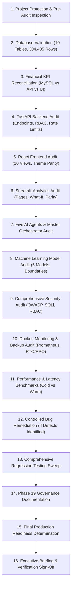

# NOVANEST — PHASE 19: END-TO-END SYSTEM VALIDATION & PRODUCTION READINESS AUDIT
## Phase Strategic Plan & Execution Protocol

**Document Version**: 1.0.0  
**Phase**: PHASE 19 (End-to-End System Validation & Production Readiness Audit)  
**Lead Roles**: Senior Software Architect, QA Lead, Data Engineer, AI Engineer, Security Auditor, DevOps Engineer  
**Date**: 2026-11-16  
**Status**: IN PROGRESS  

---

## 1. Executive Objective

Execute a rigorous, evidence-based, end-to-end audit across the entire NovaNest platform following the Phase 18 Theme Transformation. The goal is to conclusively establish the actual operational health, data accuracy, API contract consistency, multi-agent AI integrity, predictive model boundaries, security defense efficacy, container resilience, and production readiness of the complete system.

This phase is focused strictly on verification, validation, empirical measurement, regression testing, and controlled bug remediation. No platform rewrites, destructive database changes, mock data injections, or unverified feature additions will occur.

---

## 2. Core Operational Constraints & Protection Protocol

1. **Zero Destructive Database Operations**: The MySQL database `novanest_db` contains exactly 304,405 canonical rows across 10 tables. Under no circumstances will data be mutated, truncated, or dropped.
2. **Zero Hardcoded KPIs & Zero Mock Data**: All metrics must be computed dynamically from the authoritative data sources. No artificial fallbacks.
3. **Strict Git Safety**: Local verification only. Zero commits and zero pushes to GitHub.
4. **Security Integrity**: No security controls, RBAC policies, or input validation filters will be disabled or bypassed to satisfy test cases.
5. **Evidence-Based Reporting**: Every assertion must reference an executed test output, SQL query log, curl response, or visual capture.
6. **Isolated Disaster Recovery Testing**: Any database restore verification must run strictly against isolated, temporary staging tables or containers to protect the primary active instance.

---

## 3. Systematic 16-Step Execution Protocol

---

## 4. Required Phase 19 Deliverables Matrix

| File | Purpose |
|---|---|
| `PHASE_PLAN.md` | Strategic plan, audit matrix, and protection rules (this file). |
| `IMPLEMENTATION_LOG.md` | Chronological audit steps, command executions, and findings. |
| `DATABASE_AUDIT.md` | 10-table row counts, 11 FKs, 19 indexes, orphan analysis, connection pool. |
| `KPI_RECONCILIATION.md` | Cross-platform KPI comparison table (MySQL, FastAPI, React, Streamlit, PBI). |
| `API_VALIDATION.md` | FastAPI endpoint test results, RBAC verification, validation error schemas. |
| `FRONTEND_VALIDATION.md` | 10 React view inspections, console error audit, official theme validation. |
| `AI_AGENT_VALIDATION.md` | 5 Domain agents, Master Orchestrator, real query verification, safety gates. |
| `SECURITY_AUDIT.md` | Non-destructive security probe outputs, OWASP compliance, privilege review. |
| `PERFORMANCE_REPORT.md` | API, DB, UI latency benchmarks, cold vs warm cache, concurrency results. |
| `ISSUES_AND_RISKS.md` | Prioritized defect inventory (Critical/High/Med/Low) with root cause analyses. |
| `TEST_RESULTS.md` | Complete automated test suite results and execution outputs. |
| `FILE_CHANGES.md` | Registry of modified or created files during Phase 19. |
| `PRODUCTION_READINESS.md` | 13-category audit evaluation matrix and final go-live verdict. |
| `PHASE_SUMMARY.md` | Executive summary, evidence links, and operational recommendations. |
