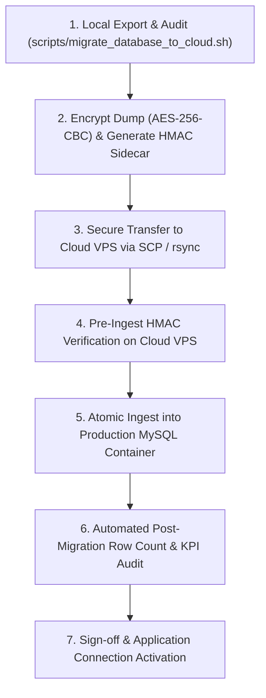

# NovaNest — Database Cloud Migration Guide
## Zero-Loss Local-to-Cloud MySQL Migration Protocol

**Document Version**: 1.0.0  
**Phase**: PHASE 20 (Public Cloud Deployment)  
**Target Canonical Rows**: Exactly **304,405 rows** across **10 tables**  
**Data Loss Allowance**: **0 rows (Zero tolerance)**  

---

## 1. Migration Overview & Target State

The NovaNest relational data store is anchored by MySQL 8.0 `novanest_db`. Migrating from the local development container to the production cloud VPS requires an atomic, transactionally consistent, encrypted migration workflow that preserves all primary keys, 11 foreign key constraints, 22 secondary indexes, and cross-table referential integrity.

### Canonical Data Inventory

| Table Name | Entity Domain | Canonical Record Count | Primary Key | Key Foreign Key References |
|---|---|:---:|---|---|
| `customers` | Customer Master | 5,000 | `customer_id` | — |
| `restaurants` | Partner Master | 1,500 | `restaurant_id` | — |
| `riders` | Fleet Logistics Master | 4,000 | `rider_id` | — |
| `promotions` | Marketing Campaigns | 200 | `promo_id` | — |
| `menu_items` | Restaurant Catalog | 15,000 | `item_id` | `restaurant_id` -> `restaurants` |
| `orders_table` | Core Order Transactions | 49,971 | `order_id` | `customer_id`, `restaurant_id`, `item_id`, `rider_id` |
| `payments` | Financial Settlements | 49,971 | `payment_id` | `order_id` -> `orders_table` |
| `deliveries` | Trip Telematics | 49,971 | `delivery_id` | `order_id` -> `orders_table`, `rider_id` -> `riders` |
| `ratings_reviews` | Customer Feedback | 28,792 | `review_id` | `order_id` -> `orders_table`, `customer_id` -> `customers` |
| `app_events` | Clickstream / Telemetry | 100,000 | `event_id` | `customer_id` -> `customers` |
| **TOTAL** | **Canonical Data Store** | **304,405** | — | **11 Foreign Keys / 22 Indexes** |

---

## 2. Step-by-Step Migration Execution Protocol



### Step 1: Execute Local Extraction & Audit
Run the automated migration export script on your local machine:
```bash
chmod +x scripts/migrate_database_to_cloud.sh
./scripts/migrate_database_to_cloud.sh
```
*Output*: Generates an AES-256 encrypted archive `backup/cloud_migration/novanest_canonical_cloud_migration.sql.gz.enc`, its HMAC-SHA256 signature `novanest_canonical_cloud_migration.sql.gz.enc.sig`, and `MIGRATION_TRANSFER_KEY.txt`.

### Step 2: Securely Transfer Archive to Cloud VPS
Transfer the encrypted package over an encrypted SSH channel:
```bash
# Set your VPS IP address
VPS_IP="159.203.x.x"

scp backup/cloud_migration/novanest_canonical_cloud_migration.sql.gz.enc* \
    root@${VPS_IP}:/var/backups/novanest/
```

### Step 3: Ingest and Restore on Cloud VPS
On the cloud VPS terminal, run the authenticated restoration script:
```bash
cd /opt/novanest
chmod +x scripts/restore_production.sh
./scripts/restore_production.sh /var/backups/novanest/novanest_canonical_cloud_migration.sql.gz.enc
```

---

## 3. Post-Migration Verification & KPI Reconciliation

Immediately after restoration, execute this SQL query inside the cloud database container to confirm data parity:

```sql
SELECT 'customers' as table_name, COUNT(*) as cnt FROM customers
UNION ALL SELECT 'restaurants', COUNT(*) FROM restaurants
UNION ALL SELECT 'riders', COUNT(*) FROM riders
UNION ALL SELECT 'promotions', COUNT(*) FROM promotions
UNION ALL SELECT 'menu_items', COUNT(*) FROM menu_items
UNION ALL SELECT 'orders_table', COUNT(*) FROM orders_table
UNION ALL SELECT 'payments', COUNT(*) FROM payments
UNION ALL SELECT 'deliveries', COUNT(*) FROM deliveries
UNION ALL SELECT 'ratings_reviews', COUNT(*) FROM ratings_reviews
UNION ALL SELECT 'app_events', COUNT(*) FROM app_events
UNION ALL SELECT 'TOTAL_CANONICAL', 
  (SELECT COUNT(*) FROM customers) +
  (SELECT COUNT(*) FROM restaurants) +
  (SELECT COUNT(*) FROM riders) +
  (SELECT COUNT(*) FROM promotions) +
  (SELECT COUNT(*) FROM menu_items) +
  (SELECT COUNT(*) FROM orders_table) +
  (SELECT COUNT(*) FROM payments) +
  (SELECT COUNT(*) FROM deliveries) +
  (SELECT COUNT(*) FROM ratings_reviews) +
  (SELECT COUNT(*) FROM app_events);
```

### Benchmark Financial Reconciliation Values
Confirm that the cloud instance computes the identical executive KPIs:
- **Total Orders**: `49,971`
- **Delivered Orders**: `47,994`
- **Delivered GMV**: `₹46,590,125`
- **Net Revenue**: `₹46,425,992`
- **Net Average Order Value (AOV)**: `₹967.33`
- **Contribution Margin**: `23.59%`
