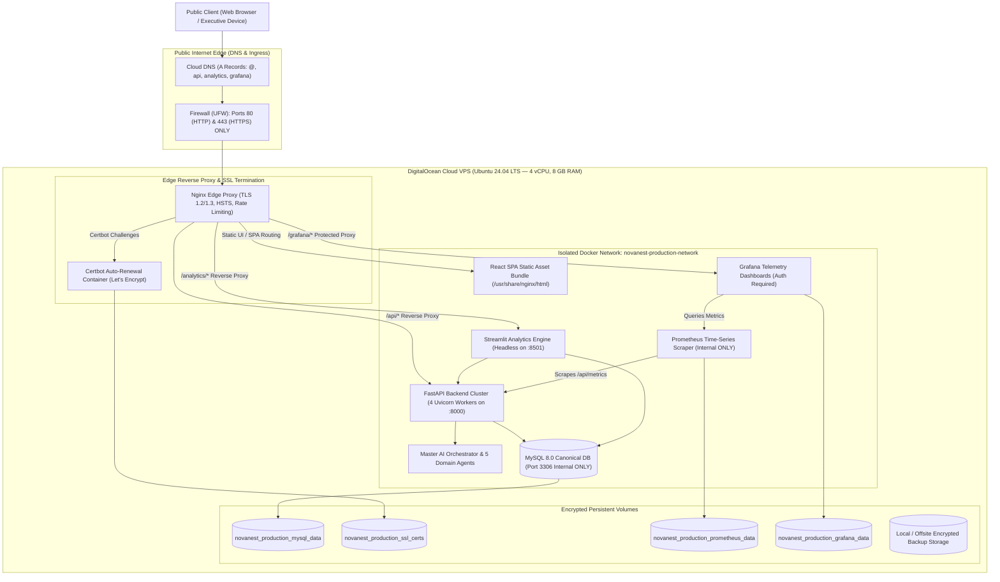

# NOVANEST — PHASE 20: PUBLIC CLOUD DEPLOYMENT
## Strategic Architecture Plan & Production Deployment Protocol

**Phase**: PHASE 20 (Public Cloud Deployment Preparation & Infrastructure Engineering)  
**Lead Roles**: Principal Cloud Architect, Senior DevOps Engineer, Infrastructure Security Specialist, Lead Data Engineer  
**Date**: 2026-11-16  
**Status**: IN PROGRESS  
**Target Platform**: DigitalOcean VPS / Linux Cloud Server (Ubuntu 22.04 / 24.04 LTS)  

---

## 1. Executive Objective

Prepare the complete, multi-tier NovaNest Food Delivery Analytics & Autonomous Decision Intelligence Platform for secure, high-availability public cloud deployment on a DigitalOcean Virtual Private Server (VPS).

The primary outcome of this phase is to establish complete operational readiness so that NovaNest can be deployed to a public cloud VPS under a custom domain (e.g., `https://novanest.example.com` or `https://novanest.app`) secured by automated Let's Encrypt TLS certificates, hardened private networking, encrypted automated backups, and unified reverse proxy routing.

This phase is conducted under strict preparation controls:
- Zero purchases of domains or cloud subscriptions.
- Zero premature public DNS or external network mutations.
- Zero modification or loss of local canonical database records (304,405 rows).
- Zero exposure of internal database or metric endpoints to the public internet.

---

## 2. Target Production Cloud Architecture

---

## 3. Strict Operating & Security Rules

1. **Firewall Isolation**: Only port 22 (SSH with pubkey authentication), port 80 (HTTP redirect & ACME challenges), and port 443 (HTTPS) are exposed on the host. MySQL (3306) and Prometheus (9090) are strictly bound to private Docker networks and must never be exposed to `0.0.0.0`.
2. **Secrets Management**: No production credentials in source control or example templates. All production keys (JWT, DB passwords, API keys) must be populated via `.env.production` on the target server.
3. **Database Integrity**: Local canonical database (304,405 records across 10 tables) must be exported to an authenticated, encrypted SQL dump (`novanest_canonical_cloud_migration.sql.enc`) and verified before cloud ingestion.
4. **Zero-Downtime SSL Lifecycle**: Certbot operates via webroot ACME challenge. Renewal runs via automated cron, signaling Nginx reload without connection dropping.
5. **Human Approval Gate**: Public IP configuration, domain DNS pointing, and cloud server provisioning will require explicit user confirmation.

---

## 4. Phase 20 Execution Roadmap

| Step | Milestone | Output / Deliverable |
|---|---|---|
| **Step 1** | Architecture Audit & Sizing Analysis | `CLOUD_ARCHITECTURE.md`, Hardware sizing matrix |
| **Step 2** | Production Compose Specification | `docker-compose.production.yml` |
| **Step 3** | Environment Variable Architecture | `.env.production.example` |
| **Step 4** | Nginx Edge Proxy & SSL Configuration | `docker/nginx.production.conf`, `SSL_CONFIGURATION.md` |
| **Step 5** | Domain, Subdomain & DNS Architecture | `DOMAIN_DNS_GUIDE.md` |
| **Step 6** | Database Cloud Migration Engineering | `DATABASE_MIGRATION_GUIDE.md`, Migration scripts |
| **Step 7** | Deployment & Automation Scripts | `scripts/deploy_production.sh`, `scripts/init_ssl.sh` |
| **Step 8** | Backup & Disaster Recovery Architecture | `BACKUP_AND_RECOVERY.md`, `scripts/backup_production.sh` |
| **Step 9** | Production Security Hardening & Audit | `SECURITY_CHECKLIST.md` |
| **Step 10** | Pre-Flight Validation & Build Verification | `TEST_RESULTS.md`, `npm run build`, Compose validation |
| **Step 11** | Master Governance & Documentation | `PHASE_SUMMARY.md`, `FILE_CHANGES.md`, Master registers |
