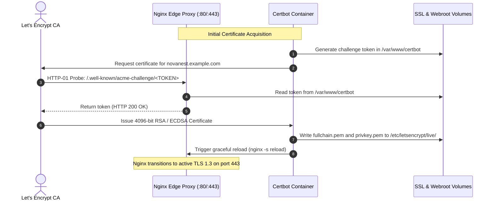

# NovaNest — SSL/TLS & HTTPS Configuration Guide
## Automated Let's Encrypt Architecture & Modern Cryptographic Hardening

**Document Version**: 1.0.0  
**Target Grade**: Qualys SSL Labs **A+ Grade**  
**Phase**: PHASE 20 (Public Cloud Deployment)  

---

## 1. Automated SSL Architecture Overview

NovaNest secures all external network traffic using automated Let's Encrypt X.509 certificates. The implementation uses the **ACME Webroot HTTP-01 challenge** orchestrated directly between Nginx and Certbot without requiring manual intervention, domain DNS API tokens, or server restarts.



---

## 2. Cryptographic Security Standards (A+ Grade Blueprint)

The production configuration in `docker/nginx.production.conf` enforces the following cryptographic parameters:

### A. Protocols & Ciphers
- **Supported Protocols**: `TLSv1.2` and `TLSv1.3` strictly. Obsolete and insecure protocols (`SSLv2`, `SSLv3`, `TLSv1.0`, `TLSv1.1`) are hard-disabled.
- **Modern Cipher Suite (Mozilla Modern Profile)**:
  - `ECDHE-ECDSA-AES128-GCM-SHA256`
  - `ECDHE-RSA-AES128-GCM-SHA256`
  - `ECDHE-ECDSA-AES256-GCM-SHA384`
  - `ECDHE-RSA-AES256-GCM-SHA384`
  - `ECDHE-ECDSA-CHACHA20-POLY1305`
  - `ECDHE-RSA-CHACHA20-POLY1305`
- **Cipher Ordering**: `ssl_prefer_server_ciphers on;`

### B. Transport Security & Headers
- **HSTS (HTTP Strict Transport Security)**:
  `Strict-Transport-Security "max-age=31536000; includeSubDomains; preload" always;`  
  Forces browsers to communicate exclusively over HTTPS for 365 days and qualifies the domain for browser HSTS preload lists.
- **Session Optimization**:
  - `ssl_session_cache shared:SSL:10m;` (allows ~40,000 cached SSL sessions)
  - `ssl_session_timeout 1d;`
  - `ssl_session_tickets off;` (prevents forward secrecy compromises)

---

## 3. Initial Certificate Bootstrap Procedure

When first deploying to a fresh VPS, Nginx requires a valid certificate path to start its port 443 listener. NovaNest handles this using a 2-step bootstrap protocol:

### Step 1: Create Self-Signed Placeholder Certificate (Temporary)
```bash
docker compose -f docker-compose.production.yml run --rm --entrypoint "\
  openssl req -x509 -nodes -newkey rsa:2048 -days 1 \
    -keyout /etc/letsencrypt/live/novanest.example.com/privkey.pem \
    -out /etc/letsencrypt/live/novanest.example.com/fullchain.pem \
    -subj '/CN=localhost'" certbot
```

### Step 2: Acquire Real Let's Encrypt Certificate
```bash
# Execute the automated SSL initializer script
chmod +x scripts/init_ssl.sh
./scripts/init_ssl.sh
```

---

## 4. Automated 60-Day Renewal & Cron Schedule

Let's Encrypt certificates are valid for 90 days. Renewal is triggered when certificates are within 30 days of expiry.

### Primary Mechanism: Background Certbot Daemon
The `certbot` container defined in `docker-compose.production.yml` runs an automated check loop every 12 hours:
```yaml
entrypoint: >
  /bin/sh -c 'trap exit TERM; while :; do certbot renew --webroot -w /var/www/certbot --quiet; sleep 12h & wait $${!}; done;'
```

### Secondary Fallback: Host Crontab Schedule
To guarantee renewal even if container processes stall, configure a weekly cron job on the host VPS:
```bash
# Add to crontab via `crontab -e`:
0 3 * * 1 /opt/novanest/scripts/renew_ssl.sh >> /var/log/novanest_ssl_cron.log 2>&1
```
