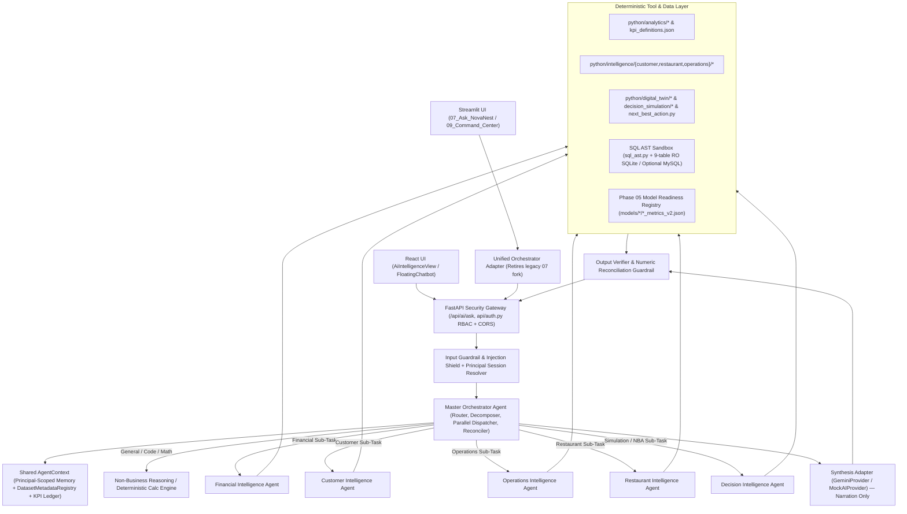

# PHASE 06 — MULTI-AGENT AI ARCHITECTURE DESIGN

- **Status**: `PROPOSED` (Architectural Blueprint — **Not Yet Implemented**)
- **Baseline Audited**: NovaNest v2.0.0 (`main` @ `21b2e2b`, Post-Phase 05.3 Security & Integration Closure)

---

## 1. Audited Current System State (`VERIFIED` & `PARTIALLY_VERIFIED`)

| Layer / Component | Current Files (`VERIFIED`) | Verified Strengths | Identified Architectural Gaps |
|---|---|---|---|
| **API Gateway & Auth** | [`api/main.py`](../../api/main.py), [`api/auth.py`](../../api/auth.py) | Explicit `CORS_ALLOWED_ORIGINS`, constant-time RBAC (`read`/`operator`/`admin`), `require_scope()`, clean JSON sanitization | `/api/ai/ask` allows `operator`, while `/api/ai/reset` demands `admin` (403 on React "New Chat" for operators); no rate-limit/timeout budget on multi-step AI turns; heavy pandas recomputation per request |
| **Universal Orchestrator** | [`python/ai/analyst/orchestrator.py`](../../python/ai/analyst/orchestrator.py) | Integrates simulation, SQL AST sandbox, Gemini/Mock provider abstraction, contextual session trace | Single `if/elif` branch dispatch (`SIMULATION`/`ROOT_CAUSE`/`NL2SQL`/`RECOMMENDATIONS`/`BUSINESS_DATA`/`CALCULATION`); cannot collaborate across domains; hardcoded fake `RECOMMENDATIONS` (`L184-206`); internal SQLite fallback loads only `6/9` tables (`L134`) |
| **Intent Classifier** | [`python/ai/analyst/universal_router.py`](../../python/ai/analyst/universal_router.py) | Protects greetings, programming, math, and project knowledge from bogus SQL/KPI injection | Pure substring/regex list; valid broad queries (e.g., *"Analyze my business performance"*, *"How many high churn customers?"*) fall back to `GENERAL`; no compound query decomposition |
| **Grounding & RCA** | [`python/ai/analyst/data_grounding.py`](../../python/ai/analyst/data_grounding.py), [`python/ai/analyst/root_cause.py`](../../python/ai/analyst/root_cause.py) | Financial branch aligns with `KPI-01` (`₹4.66 Cr`), `KPI-02` (`₹4.64 Cr`), `KPI-03` (`₹967.33`), `KPI-12` (`23.59%`); Churn branch exposes `781` (`15.62%`) + `ROC-AUC = 0.5161` caveat | `data_grounding.py` has column-name bugs (`restaurants["rating"]` -> fallback `4.2`; `alloc_df` `current_riders`/`recommended_riders` -> fallback `50/60`; unaggregated `4,669`-row leakage dump). `root_cause.py` uses fabricated prose (`"32.4 mins"`, `"5.8%"`, `"East Hub"`, `"412 accounts (8.2%)"`, `"₹12.50 Lakhs"`) |
| **SQL Security Sandbox** | [`python/ai/analyst/sql_ast.py`](../../python/ai/analyst/sql_ast.py), [`python/ai/analyst/sql_agent.py`](../../python/ai/analyst/sql_agent.py) | Recursive-descent AST parser blocking multi-statement, writes, `sqlite_master`/`sqlite_schema`, unauthorized tables; `LIMIT <= 100`, `2.0s` timeout, `PRAGMA query_only=ON` | Only `Nl2Sql` templates exist (`sql_agent.py` + `nl_to_sql.py`); no LLM-assisted parameterized SQL candidate generator gated through `validate_and_sanitize_sql()` |
| **Legacy Streamlit AI** | [`streamlit_app/pages/07_Ask_NovaNest.py`](../../streamlit_app/pages/07_Ask_NovaNest.py), [`python/ai/conversational/*`](../../python/ai/conversational/) | SQL validator delegates to `sql_ast.py` (`sql_validator.py`) | Bypasses `orchestrator.py` completely; 5-table SQLite lacks `configure_readonly_sqlite` (`L58-65`); wrong scenario keys (`commission_rate_change` in `L169-174`); unfiltered order revenue in `business_insights.py` |
| **Session Memory** | [`python/ai/analyst/conversation_manager.py`](../../python/ai/analyst/conversation_manager.py) | Stores 12 turns @ 4,000 chars with follow-up resolver | Global dict `_SESSIONS` has NO `principal.role`/hash isolation, NO TTL eviction, NO thread lock, NO structured tool/entity memory |
| **Core Analytical Engines** | `python/analytics/*`, `python/intelligence/*`, `python/digital_twin/*`, `python/decision_simulation/*`, `python/decision/*` | Complete, deterministic, clean separation across Financial, Customer, Restaurant, Operations, Twin, and Simulator domains | Rarely invoked by `orchestrator.py` (only `scenario_engine.run_scenario` is wired cleanly!) |
| **Data & ML Store** | `datasets/{cleaned,analytics,engineered}/*.csv`, `models/*/*_metrics_v2.json` | 10 cleaned, 11 engineered, 9 analytics files verified; `kpi_definitions.json` (`KPI-01`..`KPI-16`) certified | MySQL live server **`BLOCKED`** (`1045 (28000)`); `0/5` Phase 05 ML models qualify as `PRODUCTION_CANDIDATE` |

---

## 2. Target Multi-Agent Architecture (`PROPOSED`)

Instead of introducing an external microservice swarm or heavy graph orchestration server, NovaNest Phase 06 adopts an **In-Process Hub-and-Spoke Coordinated Multi-Agent Engine** inside `python/ai/` served natively by FastAPI (`api/main.py`) and consumed identically by React and Streamlit.

---

## 3. Architectural Topology Decisions (`PROPOSED`)

### 3.1 Hub-and-Spoke Orchestration + Controlled Peer-Data Exchange via Context
- **Master-First Dispatch**: Every business request passes through the `Master Orchestrator`, which classifies **multi-label domain scopes** (instead of a single `intent` string), extracts explicit filters (`city`, time window, `customer_id`, `restaurant_id`), and creates an `ExecutionPlan` DAG.
- **No Unbounded Agent-to-Agent Chat Loops**: Domain agents NEVER recursively trigger each other indefinitely (preventing latency explosions and circular loops). Cross-domain collaboration happens in at most **2 deterministic waves**:
  - **Wave 1 (Parallel Data & Diagnostics)**: Relevant domain agents (`Financial`, `Customer`, `Operations`, `Restaurant`) execute concurrently (`ThreadPoolExecutor` / `asyncio.gather` within FastAPI worker budget, `max_workers=4`, per-agent `timeout=3.0s`).
  - **Wave 2 (Synthesis & Decision Dependencies)**: `Decision Intelligence Agent` optionally runs *after* Wave 1 (or concurrently if standalone simulation) consuming structured `AgentResult` payloads (e.g., Wave 1 SLA breach rate + promo leakage candidates -> Wave 2 `scenario_engine` / `next_best_action` prioritization + `twin_dependencies` impact chains).

### 3.2 Reuse vs Refactor vs New Module Matrix

| Action | Target Modules | Rationale |
|---|---|---|
| **Reuse As-Is** | `api/auth.py`, `api/loader.py`, `python/ai/analyst/sql_ast.py`, `python/analytics/*`, `python/decision_simulation/*`, `python/digital_twin/*`, `python/decision/next_best_action.py`, `python/ai/provider/*` | Phase 04–05.3 audited & tested (`60/60` offline, `19/19` SQL security); zero reason to duplicate KPI, twin, simulation, or AST logic. |
| **Refactor & Harden** | `universal_router.py`, `data_grounding.py`, `root_cause.py`, `sql_agent.py`, `conversation_manager.py`, `orchestrator.py`, `07_Ask_NovaNest.py`, `api/main.py` (`/api/ai/reset` scope) | Fix hardcoded metrics (`root_cause.py`, `orchestrator.py` fake recommendations), CSV column bugs (`data_grounding.py`), 6->9 SQLite table parity, principal-scoped memory TTL, and Page 07 legacy fork. Preserve backward-compatible `AskNovaNestOrchestrator.process_query()` signature for existing 15 Universal AI tests. |
| **Proposed New Modules** | `python/ai/agents/{base,master_orchestrator,financial_agent,customer_agent,operations_agent,restaurant_agent,decision_agent}.py`, `python/ai/context/{agent_context,dataset_registry,kpi_registry,ml_readiness}.py`, `python/ai/guardrails/{input_shield,output_verifier}.py` | Clean domain separation with strict Pydantic `AgentTask`/`AgentResult` schemas, central registry, and automated numeric hallucination checks. |

