# PHASE 06 — SEQUENTIAL IMPLEMENTATION ROADMAP

- **Status**: `PROPOSED` (**Phase 06.0 NOT YET STARTED**)

> **Critical Sequencing Note**: Existing Phase 05.3 audit revealed latent hardcoding and schema drift inside `python/ai/analyst/{data_grounding.py,root_cause.py,orchestrator.py}` and `streamlit_app/pages/07_Ask_NovaNest.py`. Therefore, **Phase 06.0 (Stabilize Foundation Bugs)** MUST run FIRST before building multi-agent orchestration so domain agents never inherit corrupted fallbacks.

```mermaid
flowchart LR
    P60["06.0 Fix Legacy Bugs & 9-Table SQLite"] --> P61["06.1 Context, Registries & Scoped Memory"]
    P61 --> P62["06.2 Five Domain Agents + Tool Binding"]
    P62 --> P63["06.3 Master Orchestrator & Parallel DAG"]
    P63 --> P64["06.4 Security Shield & Output Verifier"]
    P64 --> P65["06.5 FastAPI Contracts & RBAC Reset Fix"]
    P65 --> P66["06.6 React & Streamlit 07 Unification"]
    P66 --> P67["06.7 Full QA, Security & Accuracy Benchmarks"]
    P67 --> P68["06.8 Documentation & Phase 06 Closure"]
```

---

## Sub-Phase Breakdown (`Phase 06.0` – `Phase 06.8`)

| Sub-Phase | Objective & Key Deliverables | Dependencies | Entry / Exit Criteria |
|---|---|---|---|
| **Phase 06.0** Legacy AI Stabilization & Grounding Repairs | Fix `data_grounding.py` (`avg_rating`, `rider_allocation.csv` columns, `4,669`-row leakage aggregation & candidate framing); eliminate fabricated strings in `root_cause.py`; replace fake NBAs in `orchestrator.py` `L184-206` with `next_best_action.py`; align local SQLite to all `9` `ALLOWED_TABLES`. | Baseline `21b2e2b` | **Exit**: `test_universal_ai_suite.py` `15/15` pass + zero hardcoded fake metrics (`32.4m`, `412`, `East Hub`, `₹12.50L`) remain in RCA/grounding outputs. |
| **Phase 06.1** Shared `AgentContext`, Registries & Scoped Memory | Implement `python/ai/context/{dataset_registry,kpi_registry,ml_readiness,agent_context}.py`; refactor `conversation_manager.py` with `RLock`, `30m` TTL, `250` LRU cap, PII masking, and HMAC principal-scoped keys; add `mtime_ns` freshness check in `api/loader.py`. | Phase 06.0 | **Exit**: Unit tests verify `kpi_definitions.json` (`16` KPIs), CSV registry schemas, TTL expiration, and zero cross-principal session bleed under concurrency. |
| **Phase 06.2** Domain Agent Suite Implementation | Build `BaseDomainAgent` Pydantic schemas (`AgentTask`, `AgentResult`) and all `5` specialists (`FinancialAgent`, `CustomerAgent`, `OperationsAgent`, `RestaurantAgent`, `DecisionAgent`) reusing existing `analytics/`, `intelligence/`, `digital_twin/`, and `decision_simulation/` modules. | Phase 06.1 | **Exit**: Each agent reconciles identically against Phase 04–05.3 API outputs (`<= 0.05` tolerance), attaches explicit ML caveats (`NEEDS_MORE_DATA`/`BASELINE_ONLY`/`EXPERIMENTAL`), and obeys `<= 3.0s` budget. |
| **Phase 06.3** Master Orchestrator, Multi-Label Router & Execution DAG | Upgrade `universal_router.py` into hybrid intent + multi-domain planner; build `MasterOrchestrator` supporting fast-path non-business queries (`RequiresBusinessData=False`), `Wave 1` `ThreadPoolExecutor` parallel agent execution, `Wave 2` `DecisionAgent` chaining, and deterministic Markdown fallback when Gemini is unavailable/errors. | Phase 06.2 | **Exit**: Benchmark queries (`single-domain`, `multi-domain compound`, `general/code/math`, `follow-up`) achieve `>= 95%` routing accuracy and preserve `AskNovaNestOrchestrator` API compatibility. |
| **Phase 06.4** Security Guardrails & Numeric Output Verifier | Implement `python/ai/guardrails/{input_shield,output_verifier}.py`: per-agent table ACL enforcement, prompt-injection delimiter isolation, `OutputVerifier` regex/value reconciliation catching LLM hallucination, and structured audit JSON logging (zero secret/PII leakage). | Phase 06.3 | **Exit**: `FakeBadProvider` hallucination test caught 100%; `>= 25` SQL + prompt injection probes blocked cleanly; per-agent table boundaries verified. |
| **Phase 06.5** FastAPI Integration & RBAC Alignment | Wire `MasterOrchestrator` + `AuthPrincipal` into `POST /api/ai/ask`; add `GET /api/ai/agents/status`; accept optional `city_filter`; adjust `POST /api/ai/reset` so `operator` can reset ONLY own scoped sessions; preserve additive `ChatResponse` fields. | Phase 06.4 | **Exit**: `test_ask_novanest_ai_suite.py` passes + negative RBAC matrix (`viewer` `403`, `operator` reset `200`, cross-token isolation) passes cleanly. |
| **Phase 06.6** React & Streamlit Frontend Unification | Update `frontend/src/services/api.ts`, `AiIntelligenceView.tsx`, and `FloatingChatbot.tsx` (`agents_invoked` pills, `"How this was calculated"` formula accordion, ML caveats banner, active `city_filter` pass-through, `ApiErrorState` on reset); migrate `streamlit_app/pages/07_Ask_NovaNest.py` off legacy `ai.conversational/*` onto unified orchestrator + `9`-table RO SQLite. | Phase 06.5 | **Exit**: `tsc -b && vite build` `0` err, `oxlint` `0`, Edge CDP confirms `AiIntelligenceView` & `FloatingChatbot` live flows + operator `"New Chat"`, Streamlit `AppTest` `10/10` pages `0` exceptions. |
| **Phase 06.7** Full Integration, Performance & Regression QA | Run complete offline + live HTTP + React + Streamlit regression suite, verify `p95 <= 800 ms` (mock/local) latency, check MySQL optional graceful fallback (`BLOCKED` noted if host `.env` still unchanged), and audit `git diff` cleanliness. | Phase 06.6 | **Exit**: 100% pass across Phase 01–06 suites (`0` regressions), all quantitative exit gates in `TESTING_STRATEGY.md` met. |
| **Phase 06.8** Phase 06 Closure Governance & Handoff | Populate `NEWCHAGES/PHASE_06/{FILE_CHANGES,IMPLEMENTATION_LOG,TEST_RESULTS,PHASE_SUMMARY}.md`, update master `NEWCHAGES/` ledgers, and run final Phase 06 closure audit prior to Phase 07/08 planning. | Phase 06.7 | **Exit**: Formal closure sign-off in `NEWCHAGES/PROJECT_AUDIT/`. |

