# NOVANEST PHASE 06.5 — ARCHITECTURE DESIGN
## MULTI-AGENT BUSINESS INTELLIGENCE SYSTEM ARCHITECTURE

- **Phase**: `06.5 — Architecture Design`
- **Date**: `2026-11-13`
- **Status**: `PROPOSED` (Grounded in Verified Phases 06.0–06.4 Implementations)

---

## 1. System Architecture Overview

The NovaNest platform combines deterministic analytics, certified KPI definitions, digital twin modeling, and a five-domain autonomous multi-agent AI architecture. In Phase 06.5, this backend intelligence is unified into an interactive, evidence-grounded **Executive Business Intelligence Experience** across web and command-center interfaces.

```mermaid
flowchart TD
    subgraph ClientLayer["Presentation Layer (Client Surfaces)"]
        ReactApp["React 19 Frontend (Vite 8.3.4)"]
        FloatingChat["Global Floating Chatbot Widget"]
        AiView["AI Intelligence View (Command Cockpit)"]
        DomainViews["Domain Dashboards (Exec, Fin, Cust, Ops, Rest, Dec)"]
        StreamlitUI["Streamlit Command Center (Port 8501)"]
    end

    subgraph GatewayLayer["API & Security Gateway (FastAPI)"]
        AuthGateway["HMAC Token Auth & RBAC Scope Filter ('read', 'operator', 'admin')"]
        RateLimiter["Input Bounds & Rate Enforcement"]
        TraceEndpoint["Trace Isolation & Execution Audit (/api/ai/traces)"]
    end

    subgraph OrchestrationLayer["Master Multi-Agent Orchestrator"]
        Router["IntentRouter (AST SQL vs General vs Single vs Multi-Agent)"]
        ContextMgr["AgentContextManager (principal_id::session_id Isolation)"]
        ConvMem["Conversational Memory & Contextual Follow-up Resolver"]
        CircuitBreaker["_AgentCircuitBreaker & Concurrency Semaphore"]
        
        subgraph ExecutionStages["Two-Stage Orchestration Pipeline"]
            Stage1["Stage 1: Parallel Domain Execution (ThreadPoolExecutor)"]
            Stage2["Stage 2: Sequential Decision Synthesis (DecisionAgent)"]
        end
        
        Synthesizer["Cross-Agent Synthesizer (synthesizer.py)"]
        Verifier["OutputVerifier (KPI Bounds, Anti-Fabrication, ML Caveats)"]
        Tracer["ExecutionTracer (Safe Spans & Secret Redaction)"]
    end

    subgraph DomainAgents["Specialized Domain Intelligence Agents"]
        FinAgent["FinancialAgent (P&L, GMV, Net Revenue, Leakage)"]
        CustAgent["CustomerAgent (RFM, CLV, Churn Risk, Cohorts)"]
        OpsAgent["OperationsAgent (SLA Breaches, Rider Workload, Heatmaps)"]
        RestAgent["RestaurantAgent (Merchant Health, Benchmark, Risk)"]
        DecAgent["DecisionAgent (Root Cause, Digital Twin, What-If, NBAs)"]
    end

    subgraph DataLayer["Underlying Data & Analytics Core"]
        CSVStore["Cleaned & Engineered CSV Store (Authoritative)"]
        SQLiteSandbox["Read-Only 9-Table SQLite AST Sandbox"]
        KPIEngine["Certified KPI Engine (KPI-01 to KPI-16)"]
        DigitalTwin["Analytical Digital Twin & Scenario Engine"]
        MySQLStore["MySQL 8.0 Enterprise (Blocked: Access Denied)"]
    end

    ClientLayer --> GatewayLayer
    GatewayLayer --> OrchestrationLayer
    OrchestrationLayer --> DomainAgents
    DomainAgents --> DataLayer
```

---

## 2. Existing System Audit & Capability Matrix

An exhaustive inspection of the existing workspace codebase reveals the following capabilities and baseline statuses:

| Component / Subsystem | Source Location | Verified Capabilities | Integration Status & Constraints |
|---|---|---|---|
| **FastAPI Backend Gateway** | [`api/main.py`](file:///C:/Users/madha/OneDrive/Documents/NovaNest-main/api/main.py), [`api/auth.py`](file:///C:/Users/madha/OneDrive/Documents/NovaNest-main/api/auth.py) | HMAC token derivation, RBAC scopes (`read`, `operator`, `admin`), strict origin CORS allowlist, `/api/ai/ask`, `/api/ai/agents/status`, `/api/ai/traces/{request_id}`, `/api/ai/reset`. Bounds validation (`400`) on inputs. | **VERIFIED**: Operational and hardened in Phase 06.4. Currently returns synchronous JSON payloads; lacks progressive streaming / SSE telemetry for long queries. |
| **Master Orchestrator** | [`python/ai/agents/master_orchestrator.py`](file:///C:/Users/madha/OneDrive/Documents/NovaNest-main/python/ai/agents/master_orchestrator.py) | `IntentRouter`, two-stage execution, `BoundedSemaphore` concurrency limit, `_AgentCircuitBreaker`, read-only retry with exponential backoff, prompt injection entry gate. | **VERIFIED**: 100% routing & selection accuracy in Phase 06.4 suite. Latency in 5-agent sweeps (~2.96s single query, ~9.6s benchmark) needs optimization. |
| **Financial Agent** | [`python/ai/agents/financial_agent.py`](file:///C:/Users/madha/OneDrive/Documents/NovaNest-main/python/ai/agents/financial_agent.py) | Certified GMV (`KPI-01`: ₹4.66 Cr), Net Revenue (`KPI-02`: ₹4.64 Cr), Net AOV (`KPI-03`), Take Rate (`KPI-04`: 22.48%), Delivery/Platform fees, promotional leakage, monthly trends, city financials. | **VERIFIED**: Deterministic math aligned with `datasets/analytics/kpi_definitions.json`. Mean latency ~408 ms. |
| **Customer Agent** | [`python/ai/agents/customer_agent.py`](file:///C:/Users/madha/OneDrive/Documents/NovaNest-main/python/ai/agents/customer_agent.py) | RFM segmentation, customer lifetime value (CLV), repeat purchase rate (`KPI-14`: 67.89%), cohort retention matrix (`KPI-15`: 54.49%), customer 360 profiles. | **VERIFIED**: Requires `operator` scope. Heavy cohort & RFM recalculations on every query add ~500 ms latency. |
| **Operations Agent** | [`python/ai/agents/operations_agent.py`](file:///C:/Users/madha/OneDrive/Documents/NovaNest-main/python/ai/agents/operations_agent.py) | SLA breach rate (`KPI-08`: 32.26%), rider utilization (`KPI-10`), zone dispatch heatmaps, logistics bottleneck alerts. Experimental ETA & Demand baseline caveats. | **VERIFIED**: Highly optimized execution (~45 ms mean latency). Enforces `ModelCaveat` warnings on experimental models. |
| **Restaurant Agent** | [`python/ai/agents/restaurant_agent.py`](file:///C:/Users/madha/OneDrive/Documents/NovaNest-main/python/ai/agents/restaurant_agent.py) | Partner health score index (`KPI-11`), merchant risk classifications (Critical, At-Risk, Stable, Top-Partner), operational throughput, peer benchmarking. | **VERIFIED**: Heavy health score calculation over 1,000 restaurants and 50,000 orders adds ~950 ms latency. |
| **Decision Agent** | [`python/ai/agents/decision_agent.py`](file:///C:/Users/madha/OneDrive/Documents/NovaNest-main/python/ai/agents/decision_agent.py) | Cross-domain synthesis, empirical Root Cause Analysis, Digital Twin systemic risk ripple chains, What-If scenario simulations, grounded Next Best Actions. | **VERIFIED**: Runs in Stage 2 sequential. Heavy calculations (re-aggregating metrics already computed in Stage 1) add ~1820 ms latency. |
| **Agent Context & Registry** | [`python/ai/agents/context.py`](file:///C:/Users/madha/OneDrive/Documents/NovaNest-main/python/ai/agents/context.py), [`registry.py`](file:///C:/Users/madha/OneDrive/Documents/NovaNest-main/python/ai/agents/registry.py) | Thread-safe context management, principal isolation, `fork_for_agent` child context branching, `AgentRegistry.lock()` runtime freeze, narrow SQL table ACLs. | **VERIFIED**: Fully tested in Phase 06.4 (`test_01_parent_and_isolated_child_cancellation_propagation`, `test_04_registry_lock`). |
| **Output Verifier** | [`python/ai/agents/output_verifier.py`](file:///C:/Users/madha/OneDrive/Documents/NovaNest-main/python/ai/agents/output_verifier.py) | Strict regex & numeric tolerance checks, percentage bounds, anti-hallucination guards, KPI definition matching, experimental ML claim checking, unconfirmed loss labeling. | **VERIFIED**: Zero unsupported claims (0.0% error rate across all evaluation runs). Legitimate rounding (`±0.5%`) preserved. |
| **Execution Tracer** | [`python/ai/agents/tracing.py`](file:///C:/Users/madha/OneDrive/Documents/NovaNest-main/python/ai/agents/tracing.py) | Thread-safe hierarchical trace recording, span timing, secret/token scrubbing (`AIza...`, `sk-...`, Bearer tokens), principal-isolated trace retrieval. | **VERIFIED**: Leaks zero secrets or PII in traces; cross-principal trace queries fail closed with `404`. |
| **React Presentation UI** | [`frontend/src/App.tsx`](file:///C:/Users/madha/OneDrive/Documents/NovaNest-main/frontend/src/App.tsx), [`views/*`](file:///C:/Users/madha/OneDrive/Documents/NovaNest-main/frontend/src/views/), [`components/*`](file:///C:/Users/madha/OneDrive/Documents/NovaNest-main/frontend/src/components/) | Vite 8.3.4 + React 19 SPA. Modern dark obsidian theme, 8 distinct dashboard tabs, `FloatingChatbot`, `AiIntelligenceView`, `AbortController` timeouts, GET-only retries. | **VERIFIED**: Production build completes in `609ms` (`RC=0`). Only `ExecutiveOverviewView` currently links to AI view; domain tabs lack contextual AI triggers. |
| **Streamlit UI** | [`streamlit_app/app.py`](file:///C:/Users/madha/OneDrive/Documents/NovaNest-main/streamlit_app/app.py), [`streamlit_app/pages/*`](file:///C:/Users/madha/OneDrive/Documents/NovaNest-main/streamlit_app/pages/) | 9-page legacy analytics cockpit with top telemetry KPIs, charts, and interactive controls. | **PARTIALLY_VERIFIED**: Page `07_Ask_NovaNest.py` is still wired to legacy `python.ai.analyst.orchestrator` instead of `MasterOrchestrator`. Needs upgrade to Phase 06 Multi-Agent engine. |
| **Data Sources** | `datasets/cleaned/`, `datasets/engineered/`, `api/loader.py` | 10 authoritative cleaned and engineered CSV datasets (50,000 orders, 50,000 deliveries, 10,000 customers, 1,000 restaurants, 150,000 events). | **VERIFIED**: Cleaned and validated. MySQL 8.0 direct connection raises `1045 (28000): Access denied`, so CSV store is authoritative runtime. |

---

## 3. Integration Gaps Identified in Existing Architecture

1. **Gap 1: Disconnected Domain Dashboards**:
   - Currently, `AiIntelligenceView` operates as an isolated destination tab. While `ExecutiveOverviewView` has a single "Ask NovaNest AI" button, the other domain views (`CustomerIntelligenceView`, `FinancialIntelligenceView`, `OperationsIntelligenceView`, `RestaurantIntelligenceView`, `DecisionIntelligenceView`) have **zero inline AI assistant integration**. Users exploring customer churn or logistics bottlenecks cannot launch context-aware AI investigations directly from their charts.
2. **Gap 2: Streamlit Architectural Split-Brain**:
   - The Streamlit application (`07_Ask_NovaNest.py`) still calls the legacy single-agent `python.ai.analyst.orchestrator.analyze_business_inquiry` function. It does not benefit from the Phase 06 multi-agent consensus, `OutputVerifier`, `ExecutionTracer`, or Stage-2 decision synthesis.
3. **Gap 3: Rigid Conversational Memory & Brittle Follow-Up Rewriting**:
   - In `python/ai/analyst/conversation_manager.py`, follow-up resolution relies on a static 5-topic pattern dictionary. Queries like `"Which city has the highest churn?"` following `"Analyze customer churn"` are misrouted or rewritten to generic questions (`"Why are customers churning and which customer segments are at risk?"`). Follow-up resolution lacks true entity tracking (`city`, `restaurant_id`, `customer_id`, `metric_name`).
4. **Gap 4: Multi-Agent Latency Overhead & Redundant Re-Computation**:
   - The multi-agent sweep latency (~2.96s single query, ~9.6s benchmark) is driven by:
     - `_slice_isolated_data` performing full deep-copies (`df.copy(deep=True)`) of 50k-row DataFrames across 5 separate agent worker threads.
     - CPython GIL contention during simultaneous pandas aggregations.
     - `DecisionAgent` re-aggregating GMV, revenue, and delivery metrics in Stage 2 that `FinancialAgent` and `OperationsAgent` already computed in Stage 1.
5. **Gap 5: Coarse-Grained Frontend Telemetry (All-or-Nothing Loading)**:
   - When a user submits a broad executive query in React or `FloatingChatbot`, the UI displays a single generic spinner until the entire multi-agent pipeline finishes. Users cannot see which agents are running, which have completed, or whether Stage 1 is finished while Stage 2 synthesizes.
6. **Gap 6: Incomplete Cross-Domain Metric Flow**:
   - Findings from `RestaurantAgent` (e.g., specific critical merchant IDs) are not automatically ingested into `CustomerAgent`'s churn context or `OperationsAgent`'s dispatch balancing during ad-hoc single-agent queries.

---

## 4. Multi-Agent Data Flow & Execution Pipeline Architecture

```mermaid
sequenceDiagram
    autonumber
    actor User as Executive / Operator
    participant UI as React UI (View / Chatbot)
    participant API as FastAPI Gateway (/api/ai/ask)
    participant Orch as MasterOrchestrator
    participant Router as IntentRouter
    participant Stage1 as Stage 1 Workers (Parallel)
    participant Stage2 as Stage 2 DecisionAgent
    participant Synth as synthesizer.py
    participant Verifier as OutputVerifier
    participant Tracer as ExecutionTracer

    User->>UI: Submits Query ("Why is profitability declining?")
    UI->>API: POST /api/ai/ask {question, session_id, client_context}
    API->>Orch: orchestrate(query, principal, session_id, data)
    Orch->>Tracer: start_trace(request_id, principal_id, session_id)
    Orch->>Router: route(query, resolved_history)
    Router-->>Orch: RoutingPlan (MULTI_AGENT, [fin, ops, rest, dec])
    
    rect rgb(20, 30, 45)
        note over Orch,Stage1: Stage 1: Concurrent Domain Execution
        par Financial Analysis
            Orch->>Stage1: FinancialAgent.execute(orders, payments, promotions)
            Stage1-->>Orch: Financial AgentResult (GMV, Net Rev, Leakage)
        and Operations Analysis
            Orch->>Stage1: OperationsAgent.execute(deliveries, riders, heatmap)
            Stage1-->>Orch: Operations AgentResult (SLA Breaches, Zone Alerts)
        and Restaurant Analysis
            Orch->>Stage1: RestaurantAgent.execute(restaurants, orders)
            Stage1-->>Orch: Restaurant AgentResult (Health Scores, At-Risk Partners)
        end
    end

    rect rgb(35, 25, 45)
        note over Orch,Stage2: Stage 2: Sequential Strategic Synthesis
        Orch->>Stage2: DecisionAgent.execute(upstream_findings=[fin, ops, rest])
        Stage2-->>Orch: Decision AgentResult (RCA, Digital Twin, NBAs)
    end

    Orch->>Synth: synthesize_agent_results(results, plan)
    Synth-->>Orch: Candidate Consolidated Response
    Orch->>Verifier: verify(consolidated_summary, agent_results)
    alt Verification Pass
        Verifier-->>Orch: VERIFIED (zero violations)
    else Verification Anomaly
        Verifier-->>Orch: REJECTED (formula inversion / unbacked claim)
        Orch->>Synth: build_rejected_limitation_response()
    end
    Orch->>Tracer: finish_trace(status, verification_outcome)
    Orch-->>API: OrchestrationOutcome
    API-->>UI: 200 OK ChatResponse (Verified Metrics, Badges, Charts, Steps)
    UI-->>User: Renders Multi-Agent Telemetry, Grounded Answer & Action Cards
```

---

## 5. Security & Isolation Architecture

1. **Authentication & RBAC Perimeters**:
   - `viewer`: Authorized for read-only status and telemetry endpoints (`/api/ai/agents/status`). Blocked with `403 Forbidden` on `/api/ai/ask` and `/api/ai/reset`.
   - `operator`: Authorized for `/api/ai/ask` and caller-owned trace retrieval (`/api/ai/traces/{request_id}`).
   - `admin`: Authorized for all endpoints including multi-session purge (`/api/ai/reset`).
2. **Context & Trace Boundary Enforcement**:
   - All session state is strictly partitioned by `make_scoped_session_key(session_id, principal_id)`.
   - Cross-principal context queries in `AgentContextManager` raise `ValueError("Principal mismatch")`.
   - Cross-principal trace access in `ExecutionTracer` fails closed with HTTP `404 Not Found`.
3. **AST SQL Execution Guardrails**:
   - Direct SQL queries or NL-to-SQL conversions are validated via `_SQLASTValidator`.
   - Only 9 whitelisted business tables (`orders`, `customers`, `restaurants`, `deliveries`, `riders`, `promotions`, `ratings_reviews`, `menu_items`, `payments`) are accessible.
   - All system tables (`sqlite_master`, `sqlite_schema`, `information_schema`), write operations (`DROP`, `INSERT`, `UPDATE`, `DELETE`, `ALTER`), PRAGMA, ATTACH, and multi-statements are blocked with `400` / `SQL_SYNTAX_OR_AST_VIOLATION`.
4. **Data Isolation & Read-Only Safety**:
   - Domain agents operate strictly on read-only views of data.
   - Any future zero-copy optimization must enforce immutability (`copy_on_write=True` or `flags.writeable = False`) to prevent cross-agent side-effects.
5. **Prompt Injection & Secret Scrubbing Perimeter**:
   - Entry queries are sanitized via `detect_prompt_injection` and `sanitize_user_query`.
   - CSV text fields (`restaurant_name`, `review_text`, `customer_name`) are sanitized via `sanitize_scalar` -> `neutralize_untrusted_text`.
   - Sensitive tokens (`Bearer `, `AIza...`, `sk-...`, JWTs, NovaNest API keys) are masked with `[REDACTED_API_KEY]` across all logs, error messages, and execution traces.

