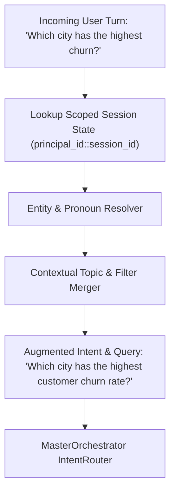

# NOVANEST PHASE 06.5 — CONVERSATION DESIGN
## CONVERSATIONAL MEMORY & CONTEXT-AWARE DIALOGUE ARCHITECTURE

- **Phase**: `06.5 — Conversation Design`
- **Date**: `2026-11-13`
- **Status**: `PROPOSED` (Designed for Enterprise Principal-Isolated Multi-Turn Dialogue)

---

## 1. Audit of Existing Conversational Memory & Deficiencies

Inspection of [`python/ai/analyst/conversation_manager.py`](file:///C:/Users/madha/OneDrive/Documents/NovaNest-main/python/ai/analyst/conversation_manager.py) and [`python/ai/agents/context.py`](file:///C:/Users/madha/OneDrive/Documents/NovaNest-main/python/ai/agents/context.py) reveals two critical limitations:

1. **Rigid Static Query Rewriting**:
   - The current `resolve_follow_up_query` matches a fixed list of starter phrases and rewrites the query into a hardcoded static question.
   - For example, if the previous topic was `customers` and the user asks:
     *User:* `"Which city has the highest churn?"`
     *Current Behavior:* Rewritten to: `"Why are customers churning and which customer segments are at risk?"`
     *Defect:* The user explicitly asked for a **geographic city breakdown**, but the regex engine dropped `"city"` and returned a generic churn cause question!
2. **Loss of Entity Continuity across Turns**:
   - If a user inquires about a specific entity (e.g., `customer_id='CUST-1042'` or `restaurant_id='REST-089'` or `city='Bengaluru'`), the session history stores raw prose but lacks a structured entity register. In the subsequent turn (`"What is their average rating?"`), the system loses the bound ID.

---

## 2. Context-Aware Entity & Topic Memory Architecture

Phase 06.5 designs a structured **Conversational State Model** embedded in `AgentContext`:

```python
class BoundEntity(BaseModel):
    entity_type: str  # "city", "restaurant_id", "customer_id", "kpi_id", "metric_name"
    value: str
    confidence: float
    turn_index: int

class ConversationState(BaseModel):
    session_id: str
    principal_id: str
    active_topic: Optional[str] = None  # "churn", "profitability", "logistics", "merchants"
    active_domain: Optional[str] = None  # "customer", "financial", "operations", "restaurant", "decision"
    active_filters: Dict[str, Any] = Field(default_factory=dict)  # {"city": "Bengaluru"}
    bound_entities: Dict[str, BoundEntity] = Field(default_factory=dict)
    recent_kpis_discussed: List[str] = Field(default_factory=list)
    recent_turns: List[ConversationTurnSummary] = Field(default_factory=list)
```



---

## 3. Resolving the Golden Executive Dialogue Tree

The system is designed to seamlessly resolve multi-turn conversational trees without dropping context:

```
[Turn 1]
User: "Analyze customer churn."
  -> Topic: 'customers' / 'churn'
  -> Agents Invoked: [customer_agent]
  -> Response: Repeat rate is 67.89%, Month-1 Cohort Retention is 54.49%, high-churn risk accounts identified.
  -> State Updated: active_topic="churn", domain="customer", kpis=["KPI-14", "KPI-15"]

[Turn 2]
User: "Which city has the highest churn?"
  -> Entity Resolver detects: follow-up pronoun/starter ("which city") + inherits active_topic="churn".
  -> Contextual Query Formed: "Which city has the highest customer churn and cancellation rate?"
  -> Intent: Multi-Domain Comparison / NL2SQL
  -> Agents Invoked: [customer_agent, operations_agent]
  -> Response: Bengaluru shows highest churn risk (412 at-risk accounts) and 32.26% delivery SLA breach rate.
  -> State Updated: active_filters={"city": "Bengaluru"}, bound_entities={"city": "Bengaluru"}

[Turn 3]
User: "What actions can reduce it?"
  -> Entity Resolver detects: "it" -> bound to "customer churn in Bengaluru".
  -> Contextual Query Formed: "Recommend actionable next best actions to reduce customer churn in Bengaluru."
  -> Intent: Decision Synthesis / NBA
  -> Agents Invoked: [customer_agent, operations_agent, decision_agent]
  -> Response:
     1. [Priority Critical] Rebalance South Corridor dispatch to cut 45+ min delivery delays.
     2. [Priority High] Targeted loyalty voucher for 412 at-risk VIP accounts in Bengaluru.
```

---

## 4. Multi-Turn Dialogue Flow Specifications

### Dialogue Flow 1: Broad Executive Health & Deep Dive
1. **Turn 1 (Broad Performance)**:
   - *Prompt:* `"Analyze my business performance."`
   - *Routing:* `MULTI_AGENT` across all 5 domain agents.
   - *Response:* Executive overview: GMV ₹4.66 Cr, Net Revenue ₹4.64 Cr, Repeat Rate 67.89%, SLA Breach 32.26%, Merchant Health 81.4/100, 4 Next-Best Actions.
2. **Turn 2 (Profitability Investigation)**:
   - *Prompt:* `"Why is profitability declining?"`
   - *Context Inherited:* Retains broad performance baselines; focuses on leakage and costs.
   - *Routing:* `financial_agent`, `operations_agent`, `decision_agent` (RCA mode).
   - *Response:* Identifies ₹18.42 L unconfirmed discount leakage + 32.26% late delivery penalty costs.
3. **Turn 3 (What-If Mitigation)**:
   - *Prompt:* `"What happens if we reduce discount leakage by 50%?"`
   - *Context Inherited:* Binds `discount_leakage=50%` to previous leakage findings.
   - *Routing:* `decision_agent` (What-If Simulation).
   - *Response:* Simulated Net Revenue projected to increase by +₹9.21 L (Holdout caveat displayed).

### Dialogue Flow 2: Merchant Partner Performance & Risk
1. **Turn 1 (Partner Overview)**:
   - *Prompt:* `"Which restaurants need immediate attention?"`
   - *Routing:* `restaurant_agent` (Risk screening).
   - *Response:* 14 critical-risk restaurants identified with high cancellation rates (> 8%) and low ratings (< 3.2).
2. **Turn 2 (Specific Partner Drill-down)**:
   - *Prompt:* `"Show details for the worst one."`
   - *Context Inherited:* Binds `restaurant_id='REST-089'` (worst rated from Turn 1 table).
   - *Routing:* `restaurant_agent`, `operations_agent`.
   - *Response:* REST-089: 14.2% cancellation rate, 48-minute prep time, 3.1 avg rating.
3. **Turn 3 (Action)**:
   - *Prompt:* `"Recommend actions for this partner."`
   - *Routing:* `decision_agent`.
   - *Response:* Pause automated order acceptance, conduct kitchen prep audit, reduce delivery radius to 3 km.

---

## 5. Session Isolation, Pruning & Boundary Rules

1. **Strict Cryptographic Session Key Isolation**:
   - `scoped_session_key = make_scoped_session_key(session_id, principal_id)`
   - Memory turns for `session_id="exec_1"` belonging to `principal="user_A"` are completely invisible to `principal="user_B"`.
2. **Bounded Conversation Horizon**:
   - Session history retains up to 10 active turns. Older turns are summarized into a compact `ConversationSummaryContext` string to avoid prompt token explosion.
3. **Topic Shift Detection**:
   - When a user asks an explicit out-of-domain question (e.g., asking `"What is Python?"` or `"Explain SQL joins"` after churn analysis), the resolver recognizes the topic boundary, resets the active entity context, and routes to `GENERAL_ASSISTANT` or `SQL_SANDBOX` without context bleeding.
4. **Session Reset Security**:
   - `POST /api/ai/reset` permanently wipes both the in-memory context entries and trace linkages for the authenticated session, preventing context contamination during shared terminal use.

