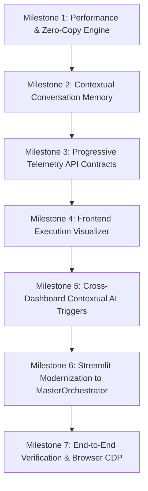

# NOVANEST PHASE 06.5 — IMPLEMENTATION ROADMAP
## STEP-BY-STEP ROLLOUT SEQUENCE & MILESTONE BLUEPRINT

- **Phase**: `06.5 — Implementation Roadmap`
- **Date**: `2026-11-13`
- **Status**: `PROPOSED` (Implementation Sequence for Future Work)

---

## 1. Phased Rollout Sequence

To ensure non-breaking changes and continuous verification, future implementation should proceed across seven sequential milestones:

---

## 2. Milestone Breakdown & Scope

### Milestone 1: Performance & Zero-Copy Engine
- **Objective**: Reduce 5-agent multi-agent sweep latency from ~2.96s to < 1.2s and peak memory from 51.4 MB to < 25 MB.
- **Key Actions**:
  - Replace `df.copy(deep=True)` in `_slice_isolated_data` with zero-copy shallow slices marked non-writeable (`pd.options.mode.copy_on_write = True`).
  - Pass pre-calculated Stage-1 ground-truth metrics (`gmv_inr`, `net_revenue_inr`, `sla_breach_rate_pct`, `total_orders`) into Stage-2 `DecisionAgent` via `upstream_findings` to skip redundant 50k-row scans.
  - Implement adaptive domain pruning in `IntentRouter`.
- **Target Verification**: Multi-agent test latency drops below 1.2s; `tracemalloc` peak memory < 25 MB.

### Milestone 2: Contextual Conversation Memory & Entity Resolver
- **Objective**: Enable natural multi-turn executive dialogue without query distortion or dropped geographic/entity filters.
- **Key Actions**:
  - Implement `ConversationState` model in `AgentContext` tracking `active_topic`, `active_filters`, and `bound_entities`.
  - Upgrade `resolve_follow_up_query` in `python/ai/analyst/conversation_manager.py` with entity extraction and pronoun resolution.
  - Test the Golden Dialogue Tree: `"Analyze customer churn"` -> `"Which city has the highest churn?"` -> `"What actions can reduce it?"`.
- **Target Verification**: Multi-turn test suite passes 100%; session isolation verified.

### Milestone 3: Progressive Telemetry & API Contract Enhancements
- **Objective**: Expose granular stage execution, data sources, and verification details over FastAPI.
- **Key Actions**:
  - Update `ChatInquiry` with `client_context` (active tab, selected entity ID) and `parent_request_id`.
  - Update `ChatResponse` with `execution_stages`, `agents_invoked`, and `verification_details`.
  - Add optional SSE streaming endpoint `GET /api/ai/ask/progress/{request_id}` for real-time progress steps.
- **Target Verification**: FastAPI TestClient suite validates 100% backward compatibility; all existing endpoints return valid schemas.

### Milestone 4: Frontend Execution Visualizer & Chatbot Polish
- **Objective**: Surface transparent multi-agent execution telemetry and follow-up chips in the React UI.
- **Key Actions**:
  - Build `AgentTelemetryCard` component displaying Orchestrator stage, agent pills, verification outcome, and data provenance.
  - Update `FloatingChatbot.tsx` with compact telemetry strip, follow-up chips, and "Expand in AI View" shortcut.
  - Update `AiIntelligenceView.tsx` with interactive Recharts, root-cause accordion, and NBA cards.
- **Target Verification**: Production build (`npm.cmd run build`) passes in < 700ms with zero TypeScript warnings.

### Milestone 5: Cross-Dashboard Contextual AI Triggers
- **Objective**: Weave contextual AI intelligence into all 6 domain dashboards.
- **Key Actions**:
  - Add contextual AI trigger buttons and pre-populated inquiry launchers to:
    - `ExecutiveOverviewView.tsx` (AI Executive Briefing banner)
    - `CustomerIntelligenceView.tsx` (Investigate Churn, VIP Retention)
    - `RestaurantIntelligenceView.tsx` (Audit Merchant Risks, Health Scores)
    - `OperationsIntelligenceView.tsx` (Diagnose SLA Breaches, Dispatch Heatmaps)
    - `FinancialIntelligenceView.tsx` (Screen Promo Leakage, City P&L)
    - `DecisionIntelligenceView.tsx` (What-If Simulation Launcher)
- **Target Verification**: Chrome CDP clicks triggers across all views, verifying seamless navigation to AI responses.

### Milestone 6: Streamlit Command Center Modernization
- **Objective**: Upgrade legacy Streamlit analytics to use Phase 06 `MasterOrchestrator`.
- **Key Actions**:
  - Update `streamlit_app/pages/07_Ask_NovaNest.py` to import and call `MasterOrchestrator` instead of legacy `analyze_business_inquiry`.
  - Surface multi-agent badges, verification status, and data provenance cards in Streamlit UI.
  - Verify Streamlit pages 01 through 09 run without runtime errors (`streamlit run`).
- **Target Verification**: Streamlit runtime test validates multi-agent consensus matching React responses.

### Milestone 7: End-to-End Evaluation, Browser CDP Verification & Final Closure
- **Objective**: Complete end-to-end regression audit and documentation closure.
- **Key Actions**:
  - Execute full 137-test unittest suite.
  - Run headless Chrome CDP test suite validating live Uvicorn + Vite Preview.
  - Update master governance ledgers under `NEWCHAGES/`.
- **Target Verification**: Zero failed tests, zero console/page errors, ports closed cleanly.

---

## 3. Future Files to Create and Modify

| File Path | Operation | Future Purpose |
|---|---|---|
| `python/ai/agents/master_orchestrator.py` | Modify | Implement zero-copy slicing, upstream metric injection, and adaptive pruning |
| `python/ai/agents/context.py` | Modify | Add `ConversationState` and entity binding dictionary |
| `python/ai/analyst/conversation_manager.py` | Modify | Upgrade `resolve_follow_up_query` with entity resolution and multi-turn state |
| `api/main.py` | Modify | Support `ChatInquiryV2`, `client_context`, and optional SSE progress endpoint |
| `frontend/src/services/api.ts` | Modify | Update TypeScript interfaces for `ClientContext`, `AgentExecutionStage` |
| `frontend/src/components/AgentTelemetryCard.tsx` | Create | Reusable multi-agent execution telemetry component |
| `frontend/src/views/AiIntelligenceView.tsx` | Modify | Embed telemetry card, Recharts visualizer, and structured RCA accordion |
| `frontend/src/components/FloatingChatbot.tsx` | Modify | Embed compact telemetry strip and "Expand to View" link |
| `frontend/src/views/ExecutiveOverviewView.tsx` | Modify | Embed Executive Briefing and KPI card AI inquiry shortcuts |
| `frontend/src/views/CustomerIntelligenceView.tsx` | Modify | Add contextual "Investigate Churn" trigger |
| `frontend/src/views/RestaurantIntelligenceView.tsx` | Modify | Add contextual "Audit Merchant Risks" trigger |
| `frontend/src/views/OperationsIntelligenceView.tsx` | Modify | Add contextual "Diagnose SLA Breaches" trigger |
| `frontend/src/views/FinancialIntelligenceView.tsx` | Modify | Add contextual "Screen Promo Leakage" trigger |
| `streamlit_app/pages/07_Ask_NovaNest.py` | Modify | Upgrade from legacy single-agent to `MasterOrchestrator` |
| `tests/test_phase06_5_integration.py` | Create | Dedicated test suite for multi-turn dialogue, zero-copy, and telemetry |

---

## 4. Rollback & Contingency Procedures

- **Zero-Copy Rollback**: If zero-copy slicing causes subtle in-place mutation bugs in pandas, revert `copy(deep=False)` to `copy(deep=True)` via a single configuration flag (`ENABLE_ZERO_COPY_SLICING = False`).
- **Conversational Memory Fallback**: If entity resolution produces low confidence on an ambiguous query, fall back immediately to the existing regex topic routing in `conversation_manager.py`.
- **SSE Stream Fallback**: If browser environments fail to establish EventSource SSE connections, client automatically falls back to standard HTTP POST.

