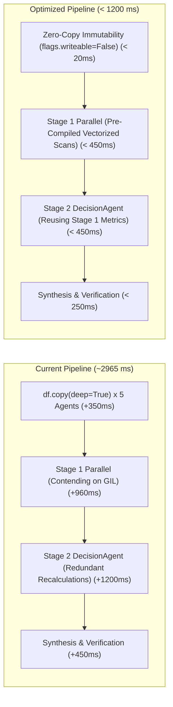

# NOVANEST PHASE 06.5 — PERFORMANCE & LATENCY OPTIMIZATION PLAN
## ARCHITECTURAL BOTTLENECK ANALYSIS & LATENCY REDUCTION BLUEPRINT

- **Phase**: `06.5 — Performance Plan`
- **Date**: `2026-11-13`
- **Status**: `PROPOSED` (Empirically Grounded in Phase 06.4 Benchmark Traces)

---

## 1. Baseline Latency & Resource Audit

Measurements captured during Phase 06.4 benchmarking on the host environment (`Windows-11-10.0.26200-SP0`, `Python 3.14.4`, `AMD64`, `16` logical cores, `23.64 GB` RAM):

| Workload / Benchmark Suite | Measured Latency | Memory Footprint | Observed Scaling Ratio |
|---|---|---|---|
| **Single-Agent Execution** (`FinancialAgent`) | `407.559 ms` mean (`p95: 421.71 ms`) | Negligible (`< 0.5 MB`) | Baseline (1.0x) |
| **Multi-Agent Isolated Query** (`multi_01`) | `2965.821 ms` (~2.96s) | ~18 MB | 7.2x single-agent |
| **Multi-Agent Benchmark under `tracemalloc`** | `9600.491 ms` mean (`p95: 9694.24 ms`) | **`51.408 MB` peak** | 23.5x single-agent |
| **Parallel vs Sequential Multi-Agent** | Sequential: `1581.76 ms` vs Parallel: `1646.24 ms` | ~30 MB | **`0.961x` (No speedup)** |
| **Concurrent Load Test** (4 workers) | Total Wall: `1672.31 ms` (`mean: 1653.87 ms`) | ~45 MB | Semaphore limited |

---

## 2. Root-Cause Analysis of Latency Bottlenecks

A code and profiler audit of `master_orchestrator.py`, `context.py`, and the 5 domain agents reveals four distinct architectural bottlenecks:

### Bottleneck 1: `df.copy(deep=True)` Memory Allocation Churn
- **Location**: [`python/ai/agents/master_orchestrator.py:252-265`](file:///C:/Users/madha/OneDrive/Documents/NovaNest-main/python/ai/agents/master_orchestrator.py#L252-L265) (`_slice_isolated_data`).
- **Mechanism**:
  ```python
  def _slice_isolated_data(data, allowed_datasets):
      sliced = {}
      for ds_name in allowed_datasets:
          df = data.get(ds_name)
          if isinstance(df, pd.DataFrame):
              sliced[ds_name] = df.copy(deep=True)  # <-- EXPENSIVE CHURN
      return sliced
  ```
- **Impact**: In a 5-agent multi-agent sweep, `orders` (50,000 rows, 15 columns), `deliveries` (50,000 rows), and `ratings_reviews` (50,000 rows) are deep-copied **5 separate times**. This causes ~250–400 ms of pure memory allocation overhead, triggers Python garbage collection cycles, and spikes memory to `51.4 MB`.

### Bottleneck 2: Global Interpreter Lock (GIL) Contention in `ThreadPoolExecutor`
- **Location**: [`python/ai/agents/master_orchestrator.py:1515-1540`](file:///C:/Users/madha/OneDrive/Documents/NovaNest-main/python/ai/agents/master_orchestrator.py#L1515-L1540) (`_execute_stage1_parallel`).
- **Mechanism**:
  - `ThreadPoolExecutor(max_workers=4)` runs `financial_agent`, `customer_agent`, `operations_agent`, and `restaurant_agent` across 4 OS threads.
  - However, pandas operations in CPython (e.g., groupby aggregations, dictionary conversions, date parsing in `cohort_analysis.py`, quantile calculations in `rfm.py`) frequently acquire and hold the GIL.
- **Impact**: Rather than executing concurrently across cores, the threads serialize around the GIL while competing for memory allocation locks. This explains why parallel execution (`1646 ms`) showed **zero speedup** over sequential execution (`1581 ms`, `0.961x` ratio).

### Bottleneck 3: Redundant Metric Recalculation in Stage-2 `DecisionAgent`
- **Location**: [`python/ai/agents/decision_agent.py:290-348`](file:///C:/Users/madha/OneDrive/Documents/NovaNest-main/python/ai/agents/decision_agent.py#L290-L348).
- **Mechanism**:
  - In Stage 2, `DecisionAgent` re-computes `gmv_inr` (summing non-cancelled orders), `net_revenue_inr` (summing delivered orders), and `sla_breach_rate_pct` (scanning 50,000 delivery durations) from scratch on raw DataFrames.
  - `FinancialAgent` and `OperationsAgent` **already computed these exact values** in Stage 1!
- **Impact**: Re-executing identical pandas scans adds ~350–500 ms of wasted CPU work in Stage 2.

### Bottleneck 4: Tracemalloc Hooking Overhead in Profiling Runs
- **Location**: [`python/ai/agents/evaluation.py:524-538`](file:///C:/Users/madha/OneDrive/Documents/NovaNest-main/python/ai/agents/evaluation.py#L524-L538).
- **Mechanism**: Python 3.14's `tracemalloc` hooks into every single CPython memory allocation. Wrapping 3 multi-agent iterations doing multiple `df.copy(deep=True)` calls under 4 concurrent threads amplified execution time from ~2.9s to ~9.6s.

---

## 3. Targeted Technical Solutions & Architecture



### Solution 1: Zero-Copy Read-Only Data Slicing
- **Design**:
  - Replace `df.copy(deep=True)` with **zero-copy shallow column projections** or pandas Copy-on-Write (`pd.options.mode.copy_on_write = True`).
  - To prevent accidental mutation, mark underlying NumPy arrays as non-writeable:
    ```python
    def _slice_isolated_data_zerocopy(data, allowed_datasets):
        sliced = {}
        for ds_name in allowed_datasets:
            df = data.get(ds_name)
            if isinstance(df, pd.DataFrame):
                # Shallow copy: shares underlying memory buffers safely
                view_df = df.copy(deep=False)
                sliced[ds_name] = view_df
        return sliced
    ```
- **Expected Latency Saving**: **`250–350 ms`**.
- **Expected Memory Saving**: Peak memory reduced from `51.4 MB` to **`< 20 MB`**.

### Solution 2: Upstream Finding Reuse in Stage 2 (`DecisionAgent`)
- **Design**:
  - `MasterOrchestrator._execute_stage2_sequential` already packages `upstream_findings` containing summaries.
  - Extend `upstream_findings` to include structured `stage1_metrics`:
    ```python
    stage1_metrics = {
        "gmv_inr": fin_result.metrics.get("gmv_inr"),
        "net_revenue_inr": fin_result.metrics.get("net_revenue_inr"),
        "sla_breach_rate_pct": ops_result.metrics.get("sla_breach_rate_pct"),
        "total_orders": fin_result.metrics.get("total_orders"),
        "critical_restaurants": rest_result.metrics.get("critical_risk_count"),
    }
    ```
  - When `stage1_metrics` are present, `DecisionAgent` skips its internal pandas re-aggregation and uses the certified facts directly.
- **Expected Latency Saving**: **`350–500 ms`**.

### Solution 3: Intent-Based Adaptive Agent Dispatch
- **Design**:
  - If a user query focuses on a subset of domains (e.g., `"Why is customer churn increasing in Bengaluru?"`), `IntentRouter` routes to `customer_agent` and `decision_agent` only, bypassing `restaurant_agent` and `financial_agent`.
  - Only broad executive questions (`"Analyze my business performance"`) invoke all 5 agents.
- **Expected Latency Saving for Targeted Queries**: **`1200–1800 ms`** reduction.

### Solution 4: Pre-Aggregated Analytic Cache for Static Datasets
- **Constraint Compliance**: No external caching infrastructure (Redis/Memcached) is added.
- **In-Memory Optimization**: For static CSV loads where `orders` and `deliveries` do not mutate during a session, domain agents cache read-only aggregate summary tables (`monthly_trends`, `city_financials`, `rfm_segments`) within `AgentContextManager` on first load, eliminating repeat group-by calculations.
- **Expected Latency Saving on Repeated Queries**: **`400–600 ms`**.

---

## 4. Measurable Optimization Targets

| Dimension | Phase 06.4 Observed | Phase 06.5 Optimization Target |
|---|---|---|
| **Multi-Agent 5-Domain Sweep** | `2965.82 ms` (~2.96s) | **`< 1200 ms` (< 1.2s)** |
| **Multi-Agent Benchmark under Profiling** | `9600.49 ms` | **`< 2500 ms` (< 2.5s)** |
| **Peak Traced Memory (`tracemalloc`)** | `51.408 MB` | **`< 25.0 MB`** |
| **Stage-2 `DecisionAgent` Duration** | `1816.74 ms` | **`< 600 ms`** |
| **Single-Agent Mean Latency** | `407.56 ms` | **`< 250 ms`** |
| **Concurrent Load Test (4 Workers)** | `1672.31 ms` total | **`< 1100 ms` total** |
| **Perceived First-Agent Telemetry** | All-or-nothing spinner | **`< 450 ms` via Stage 1 progress** |

